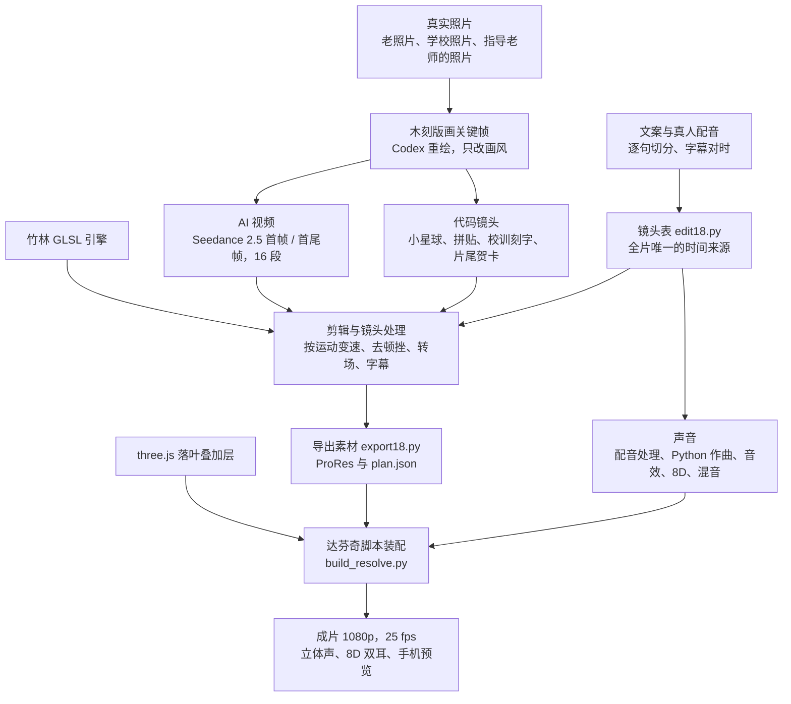
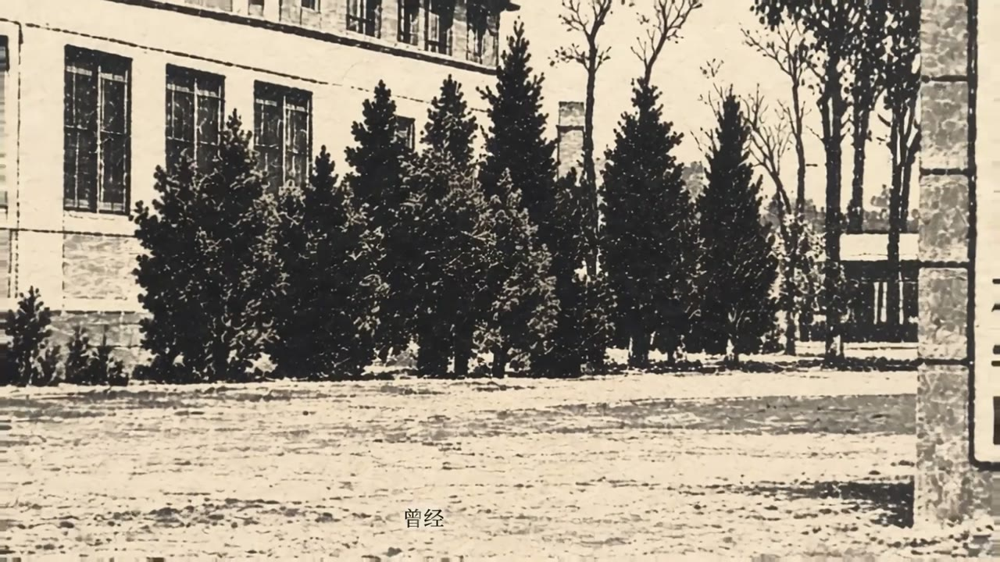
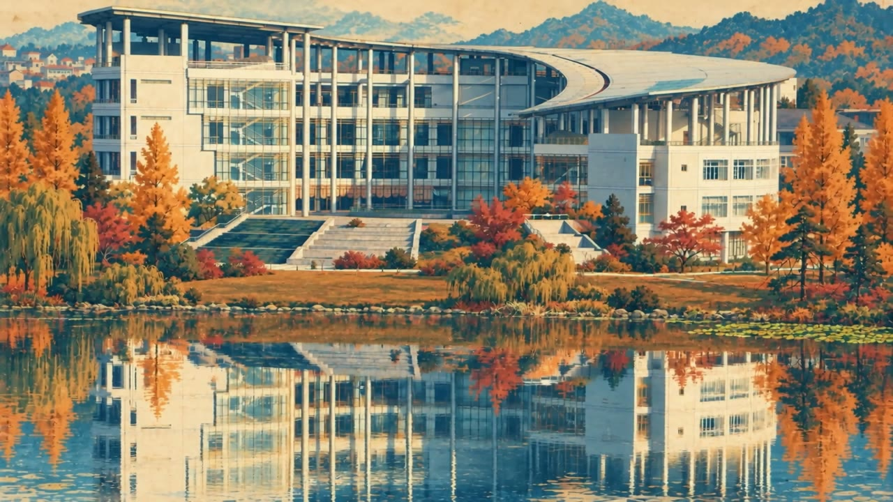

# 浙江农林大学 68 周年宣传片是如何搭建的

**Living Woodblock: how the ZAFU 68th-anniversary film was made**


《活的版画》是为浙江农林大学建校 68 周年（1958 到 2026）做的一部 110 秒宣传片。整部片子是一张“会动的江南木刻版画”：校门、东湖、图书馆、竹林、银杏、校训石，先由真实照片重绘成同一种木刻版画风格，再用 AI 视频、代码动画和 three.js 让它动起来，最后在达芬奇里合成。

这个仓库公开整部片子从文案到成片的制作方法：每一步的输入、用到的工具和脚本、具体参数、输出，以及怎么检查。

---

## 成片规格

| 项目 | 规格 |
|---|---|
| 时长 | 110 秒（25 fps，2750 帧） |
| 画面 | 1920×1080，H.264 |
| 声音 | AAC 48 kHz 立体声；另有 8D 双耳版（戴耳机听） |
| 响度 | 整片 -16 LUFS，真峰值约 -2.2 dBTP |
| 配音 | 周文韬（真人配音） |
| 硬件 | 一台 MacBook Pro：Apple M3 Max，128 GB 内存 |
| 软件 | DaVinci Resolve Studio 21.1、FFmpeg、Python、Node.js 与 three.js；图像模型 GPT Image（经 Codex CLI）；视频模型 Seedance 2.5（经 LibTV）；本地模型 Depth Anything V2、LaMa、Whisper、CLAP 等，见 [ASSETS.md](ASSETS.md) |

## 这部片子是怎么做的

- **作者**：定方向、看每一版画面和声音，决定每一处修改。
- **指导老师陈胜伟**：给出内容上的意见，提供了今天的东湖校门、校园森林和木化石的照片。
- **配音周文韬**：全片的旁白和结尾“生日快乐”都是周文韬的真人录音，片子的气质很大程度上由这把声音定下来。
- **AI 编程助手 Claude Code**：在作者的 Mac 上写 Python 和 JavaScript 脚本并运行；通过 Codex CLI 生成版画关键帧，通过 LibTV 的 MCP 接口调用 Seedance 2.5 生成视频，通过 DaVinci Resolve 的脚本接口装配时间线；逐帧检查画面和声音。
- **只用真实素材**：画面内容来自真实照片和事实：校友总会“母校印记”“忆母校的门”栏目的老照片、学校官方公众号的照片、指导老师提供的照片和校园实拍参考。只重绘画风，不编造场景，片中不出现人物。

所有步骤都写成了脚本，所以每一步都能重跑、能检查。

## 整体流程



两个关键做法：

- 所有时间只写在一处：镜头表 `work/v16k/edit18.py`。每个镜头的起止、取哪段素材、怎么变速、转场在哪里、每一行字幕什么时候出现，都由它定义；导出素材、配乐对点、音效位置和达芬奇时间线都从它出发。
- 画面风格只有一种：所有镜头先变成同一套木刻版画关键帧，再由 AI 视频、代码或 three.js 让它动起来。每段 AI 视频只生成一次，逐段质检，记下可用区间和瑕疵，剪辑时取可用的部分，瑕疵用裁切或转场遮住。

## 文档目录

按制作顺序阅读：

| 章节 | 内容 |
|---|---|
| [00 制作环境与工具链](docs/00_制作环境与工具链.md) | 机器与软件版本、两个 Python 环境、AI 助手怎样调用 Codex、LibTV 和达芬奇、全片约定与目录 |
| [01 文案、配音与时间表](docs/01_文案配音与时间表.md) | 旁白全文、真人配音的切句与结尾补录的匹配、字幕逐句对时、全片 27 个镜头的时间表 |
| [02 照片变成版画关键帧](docs/02_照片变成版画关键帧.md) | 真实照片的来源与清理、代码排版、Codex 批量重绘、提示词规则、每一张关键帧 |
| [03 AI 视频：Seedance 2.5](docs/03_AI视频_Seedance.md) | LibTV 与 Seedance 2.5、首尾帧接力、提示词写法、提交与下载、逐段质检、16 段的完整提示词 |
| [04 代码镜头、竹林引擎与 three.js](docs/04_代码镜头竹林与three.js.md) | 小星球开场、卡片拼贴、研究图版、校训刻字、静帧推移与叠加层、竹林 GLSL 引擎、three.js 落叶 |
| [05 剪辑与镜头处理](docs/05_剪辑与镜头处理.md) | 镜头表怎样变成画面、按运动量变速、AI 视频去顿挫、手柄、全部转场的算法与位置、字幕样式 |
| [06 片尾：校庆生日贺卡](docs/06_片尾_校庆生日贺卡.md) | 年轮从髓心一圈圈长出，校名印出，“生日快乐”与配乐全奏和弦同时落在 106 秒 |
| [07 声音](docs/07_声音.md) | 配音处理链、Python 作曲与采样音源渲染、CLAP 筛选音效、音效设计、8D 双耳、混音到 -16 LUFS |
| [08 达芬奇装配、输出与检查](docs/08_达芬奇装配输出与检查.md) | 导出素材与 plan.json、用脚本装配时间线、渲染与交付、跳变扫描、接缝联络表、响度检查 |

第三方软件、模型、素材和数据的来源与许可见 [ASSETS.md](ASSETS.md)。

## 截图

| | |
|---|---|
|  |  |
| 开场：宣纸上的“一粒种” | 翅果落地发芽（AI 视频） |
|  |  |
| 建校初期的天目林学院校门（老照片重绘） | 今天的校门 |
|  |  |
| 东湖与图书馆，二十年后岸边成林（AI 视频） | 树苗长成挂满翅果的大槭树（AI 视频与 three.js 落叶） |
|  |  |
| 博览古今：木化石 | 校训石“求真敬业”金字刻出 |
|  |  |
| 黑天鹅（AI 视频） | 片尾：年轮贺卡，10.25 校庆 |

全片联系表（每 4 秒一帧）：


## 仓库结构

```
zafu68-living-woodblock/
├── README.md
├── ASSETS.md          第三方软件、模型、素材与内容来源：链接、许可、在片中的用途
├── docs/              按制作顺序的 9 章文档
├── scripts/           最终流程实际用到的脚本，按章节分文件夹
│   ├── 00_tools/          环境配置
│   ├── 01_text_voice/     配音切句与字幕对时的数据和脚本
│   ├── 02_keyframes/      照片收集、排版、Codex 批量任务与提示词
│   ├── 03_ai_video/       AI 视频质检脚本与 16 段的参数和提示词（clips.json）
│   ├── 04_code_shots/     代码镜头、竹林 GLSL 引擎（zafu_v1/）、three.js 落叶（libtv_jobs/fx/）
│   ├── 05_edit/           镜头表 edit18.py、变速、去顿挫、转场
│   ├── 06_ending/         片尾贺卡的 Codex 任务
│   ├── 07_sound/          作曲、音效设计、混音；共用声音引擎（naiwa_engine/）
│   └── 08_resolve_output/ 导出素材、达芬奇装配、检查
├── images/            成片截图与全片联系表
├── LICENSE            代码：MIT
└── LICENSE-docs.md    文档：CC BY 4.0；截图：保留所有权利
```

每个章节文件夹里保留原工程的相对路径。例如原工程的 `work/v16k/edit18.py` 在仓库里是 `scripts/05_edit/work/v16k/edit18.py`。文档里提到脚本时写的都是原工程路径，前面加上章节文件夹就能找到。脚本里的个人目录已经改写成 `~`，详见 [scripts/README.md](scripts/README.md)。

本仓库只放脚本、数据和文档，不放视频、照片、配音和模型文件；照片和配音的来源见 [ASSETS.md](ASSETS.md)。

## 致谢

- 配音：周文韬
- 指导老师：陈胜伟
- 老照片：浙江农林大学校友总会“母校印记”“忆母校的门”栏目，浙江农林大学官网与官方公众号
